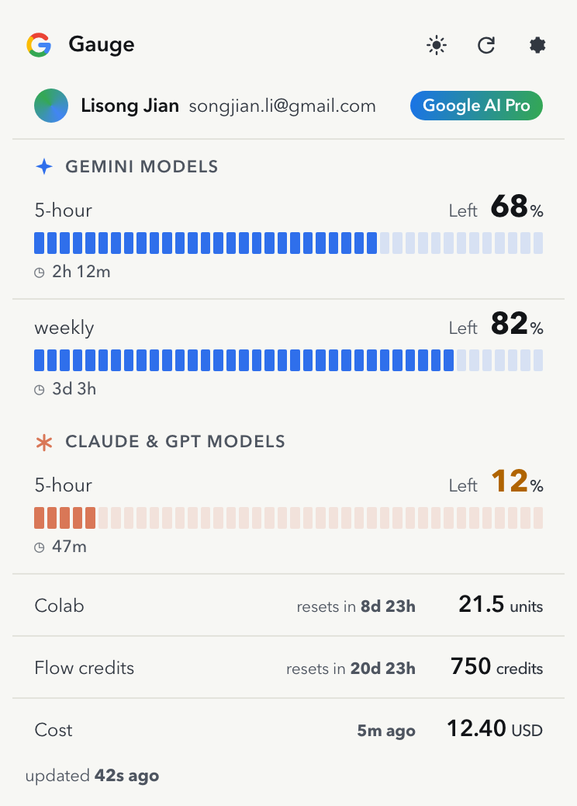

# Gauge

A macOS menu-bar dashboard for Gemini / Google Cloud quota and spend. Click the
tray icon and see, without opening anything else: Antigravity plan and model
pools (5 h / weekly), Gemini CLI calls today, BigQuery credit burn, Colab compute
units, Flow video credits.

<p align="center">
  <picture>
    <source media="(prefers-color-scheme: dark)" srcset="docs/popover-dark.png">
    
  </picture>
</p>

Collectors poll upstream on a quiet schedule and write snapshots to an embedded
SQLite file; the UI only reads local data, so the popover opens instantly and
never triggers extra billing or rate limits. A headless HTTP build serves the
same UI for a server or a container.

## Install

Download `Gauge-x.y.z-macos-universal.zip` from
[Releases](https://github.com/abcdlsj/gauge/releases), move `Gauge.app` to
`/Applications`. The bundle is ad-hoc signed, not notarised: on first launch use
right-click → Open, or

```sh
xattr -dr com.apple.quarantine /Applications/Gauge.app
```

Requires macOS 13+. Builds for Apple Silicon and Intel (universal).

## Where the data lives

| What | Path |
| --- | --- |
| Database | `~/Library/Application Support/Gauge/quota.db` (+ `-wal`, `-shm`) |
| Encryption key | `~/Library/Application Support/Gauge/gauge.key` (0600, AES-GCM) |
| Headless build | `-db` / `GAUGE_DB`, key defaults to `gauge.key` next to it |

Everything Gauge produces stays in that folder: quota snapshots, run state, an
activity log, and settings — anything token-, cookie- or secret-shaped is
encrypted before it is written. There is no server, no telemetry, no analytics.

Read-only, never modified: `~/.gemini/antigravity/daemon/hub_*.json`,
`~/.gemini/oauth_creds.json`, `~/.config/gcloud/application_default_credentials.json`,
and Chrome's `Cookies` / `Local State` (copied to `$TMPDIR` for the read, then
deleted).

## What it collects

| Provider | Cadence | Source |
| --- | --- | --- |
| Antigravity | 5 min | the IDE's own local language server; Cloud Code API when the IDE is closed |
| Cloud Monitoring | 10 min | `api/request_count` — Gemini CLI calls today (Pacific) |
| GCP billing | 6 h | BigQuery billing export, incremental over `_PARTITIONTIME` |
| Colab | 30 min | `clients6.google.com` GetUserInfo — compute units, accelerator classes |
| Google Flow | 30 min | VideoFx GetCredits — video credit balance and reset date |
| Command Code | 5 min | `/alpha/billing/credits` — 5-hour and weekly plan windows, credits; key from settings or `~/.commandcode/auth.json` |
| Open Design | 5 min | workspace billing preflight — Design Plan windows, USD balance; control key from settings or `~/.amr/config.json` |

Antigravity is read from the running IDE first: `hub_<port>.json` gives the pid,
port and CSRF token of its language server, and Gauge makes the same loopback
calls the IDE makes. No OAuth, no credentials, no extra session. Only when the
IDE is closed does it fall back to a loopback OAuth flow, and the refresh token
is encrypted into the database.

Billing keeps a cursor in the database instead of rescanning: each cycle reads at
most one extra day of partitions.

## Compared with the other tools

| | **Gauge** | [Antigravity-Manager](https://github.com/lbjlaq/Antigravity-Manager) | [antigravity-panel](https://github.com/n2ns/antigravity-panel) | [AntigravityQuotaWatcher](https://github.com/wusimpl/AntigravityQuotaWatcher) |
| --- | --- | --- | --- | --- |
| Shape | menu bar app + headless HTTP build | desktop account manager | in-IDE panel | IDE extension |
| Focus | quota **and money**, all sources in one place | adding / switching / rotating accounts | IDE quota plus usage trends | IDE quota display |
| Antigravity quota | yes | yes | yes | yes |
| Spend / billing | BigQuery credits, CLI calls, Colab CU, Flow credits | no | no | no |
| Changes anything upstream | never | yes — it manages accounts | yes — IDE cache cleanup, auto-accept | no |
| Multi-account | reads the account(s) you signed in with | yes, that is the point | single | single |
| Leaves the machine | no | reports/console | no | no |

If what you want is to juggle several Antigravity accounts, use
Antigravity-Manager. If you want to live inside the IDE, use the panel or the
extension. Gauge exists because none of them answer "how much does this month
cost me, and how much of the plan is left" in one glance from the menu bar, and
because a menu bar hop is cheaper than opening an IDE to look at a number.

## Why this shouldn't get an account banned

Read it as: what Gauge does *not* do is most of the risk surface.

| Data source | How | Risk |
| --- | --- | --- |
| GCP billing / monitoring | OAuth + documented APIs | none |
| Antigravity, local | loopback RPC to the IDE's own language server | none — same call the IDE makes |
| Antigravity, IDE closed | OAuth with the client the desktop app ships | low; read-only, no other endpoints |
| Colab / Flow | your browser cookie + the internal gRPC-Web endpoint the web UI uses | the real one — see below |

The last row is the only one that leans on Google's "no automated access"
clause. It is also read-only and deliberately slow:

- no write path in the code: nothing is generated, reset, transferred, or
  switched — there is no API that could
- frequency floors are enforced per collector (5 min Antigravity, 10 min
  monitoring, 30 min Colab/Flow, 60 min billing) and manual refresh has a 60 s
  cooldown, so a stuck window cannot hammer an endpoint
- requests carry your existing session, exactly as a page load would, one
  account at a time — no rotation, no parallel fan-out
- a 401/403/429 puts the collector in `expired_auth` and stops polling it until
  you provide credentials again, instead of retrying
- turning Chrome cookies off and leaving the pasted cookie empty makes Colab /
  Flow `unconfigured`: no network call at all
- the server is loopback-only by default and refuses to bind a public address
  without `GAUGE_AUTH`

Honest caveats: those internal endpoints have no stability guarantee (a moved
endpoint and a `403` are both things this codebase already hit), and Google can
change the rules at any time. If that matters more than the numbers, turn the
cookie-based collectors off.

Gauge is not affiliated with, endorsed by, or supported by Google.

## Settings

**Settings** → per source page with last run and **Refresh now**. Every field
saves on its own; secrets go through an inline editor and cleared fields fall
back to their default. Missing credentials are harmless — the collector reports
`unconfigured` and makes no request.

Credentials resolve in two independent chains, because Antigravity and Cloud APIs
are often different accounts:

| Chain | Order |
| --- | --- |
| Antigravity | `antigravity_refresh_token` → `google_refresh_token` → `~/.gemini/oauth_creds.json` |
| GCP | `gcp_sa_json` → ADC file → `gcp_refresh_token` → `google_refresh_token` |

Optional: `webhook_url` receives a JSON alert when a provider changes state;
`browser_cookies` (default `chrome`) reuses the local Chrome profile instead of a
pasted cookie.

Cards are grouped by subscription: **Google AI Ultra/Pro** (named after the
account's plan) holds the Antigravity Gemini and Claude pools, Flow credits and
Colab compute units; Command Code, Open Design and Google Cloud are groups of
their own. In Settings, drag subscriptions (and the cards inside one) to set
the menu-bar order, and switch either level off. The layout is stored as
`display_layout` and also drives the web Overview; the web build adds one tab
per subscription with all of its cards.

## Build from source

```sh
make app      # build/bin/Gauge.app — needs macOS + Xcode command line tools
make run-app
make test     # go test ./...
make build    # headless binary only, CGO-free
```

`make app` needs the icon, which `scripts/make_icons.py` draws — one geometry in
SVG that also produces the committed menu-bar template and `web/mark.svg`.

```
cmd/gauge          Wails menu-bar shell
cmd/gauge-server   headless HTTP entrypoint
internal/app       wiring: store, engine, routes, auth
internal/store     SQLite snapshots, run state, events, encrypted settings
internal/engine    per-provider scheduling, cooldown, alert webhook
internal/providers antigravity · gcp-billing · gcp-monitoring · colab · flow
internal/browsercookie  read (and decrypt) cookies from the local Chrome profile
web                index.html · app.css · app.js (no framework)
```

## Headless / environment

```sh
./gauge -db /var/lib/gauge/quota.db -addr 127.0.0.1:8090
```

| Variable | Default | Meaning |
| --- | --- | --- |
| `GAUGE_ADDR` | `127.0.0.1:8090` | listen address |
| `GAUGE_DB` | `quota.db` | SQLite file |
| `GAUGE_KEY` | `<db dir>/gauge.key` | encryption key file |
| `GAUGE_SECRET_KEY` | — | passphrase instead of a key file |
| `GAUGE_AUTH` | — | `user:password` for HTTP Basic auth |
| `GAUGE_ALLOW_PUBLIC` | — | `1` allows a non-loopback bind without auth |

Routes: `GET /api/overview`, `GET /api/quotas`, `GET|POST /api/settings`,
`POST /api/refresh/{provider}` (60 s cooldown), `POST /api/refresh-all`,
`GET /api/oauth/start`, `GET /oauth/callback`, `GET /api/health`.

The page loads no third-party assets; the CSP is `default-src 'self'`.
